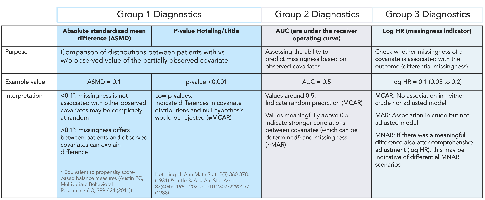
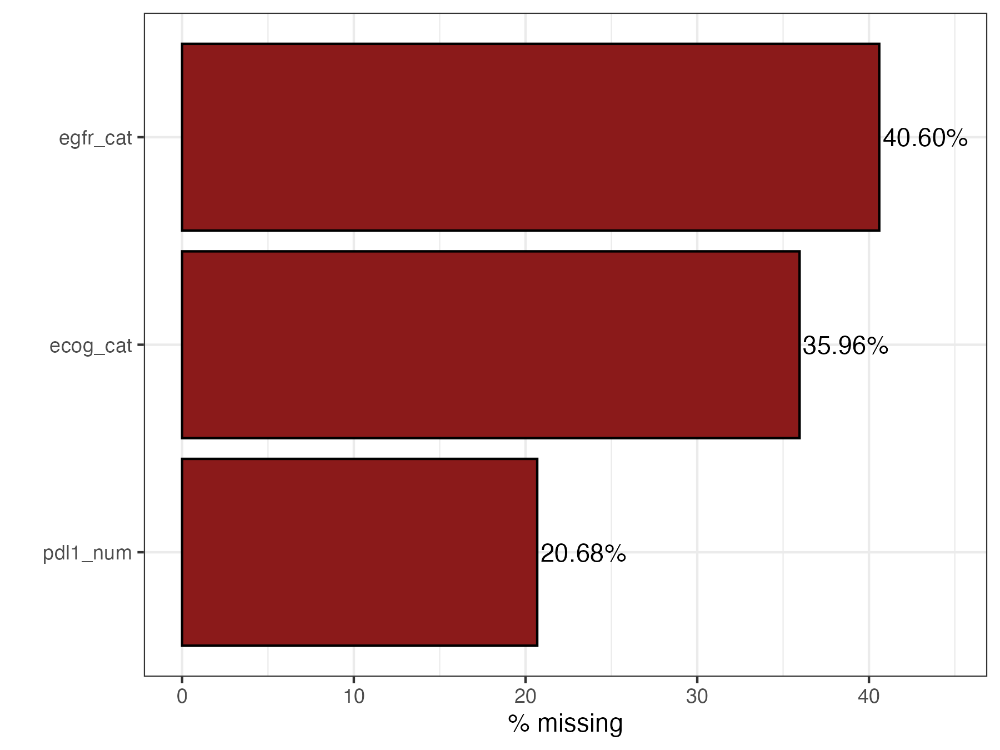
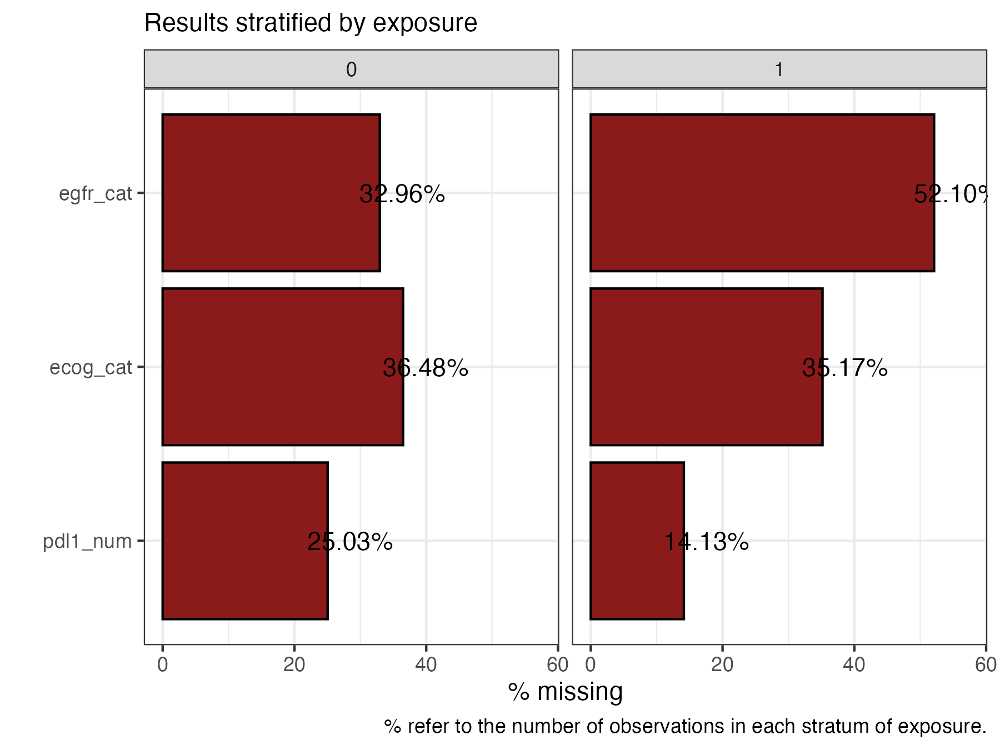
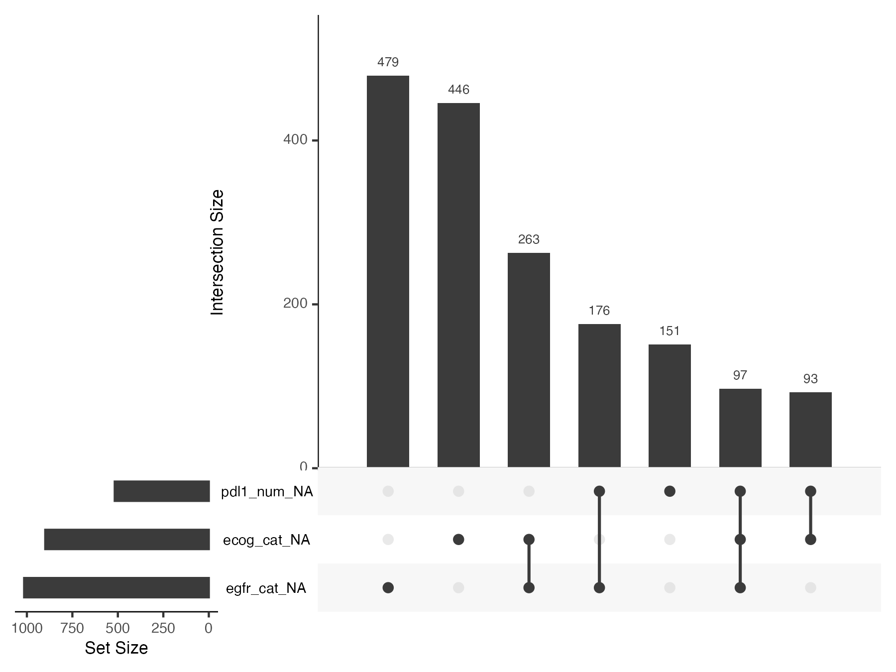
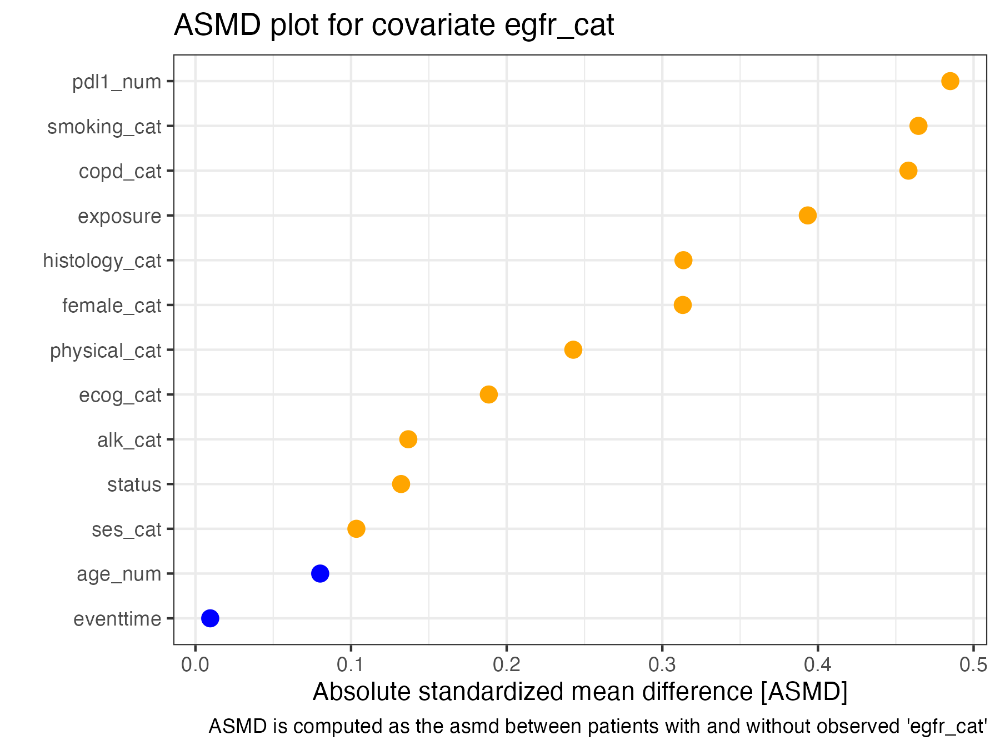
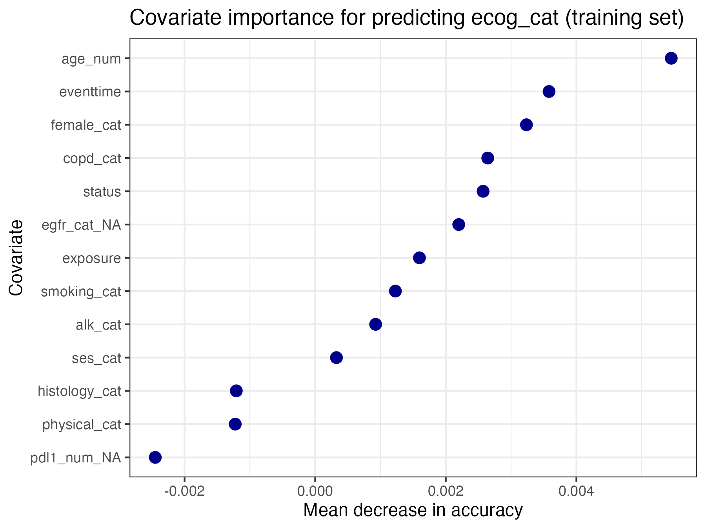

# Routine structural missing data diagnostics

``` r
library(smdi)
library(gt)
#> Warning: package 'gt' was built under R version 4.5.2
library(dplyr)
library(here)
library(knitr)
```

## `smdi` main functionalities

The `smdi` flagship function is
[`smdi_diagnose()`](https://janickweberpals.gitlab-pages.partners.org/smdi/index/reference/smdi_diagnose.md)
which calls multiple sub-functions which are also accessible separately.
This article aims to give an introduction to missing covariate data
diagnostics using the individual `smdi` diagnostics function that all
funnel into the main function
[`smdi_diagnose()`](https://janickweberpals.gitlab-pages.partners.org/smdi/index/reference/smdi_diagnose.md).

**What is smdi about?** Large-scale simulations revealed characteristic
patterns of diagnostic parameters matched to common missing data
structures based on three group diagnostics:



Overview three group diagnostics

**How can this be applied to inform a real-world database study?** The
observed diagnostic patterns of a specific study will give insights into
the likelihood of underlying missingness structures. This package
enables researchers to create these three group diagnostics for their
own healthcare database analytics with little effort. This is how an
**example** could look like in a real-world database study:


Example of how `smdi` diagnostics can be applied to give insights into
the likelihood of underlying missingness structures in a real-world
database study.

### Illustrative dataset

To illustrate the usage of the `smdi` package main functions, we use the
`smdi_data` dataset which is an example dataset that comes bundled with
the package and includes some ready to use simulated partially observed
covariates. If you prefer to simulate missingness yourself, you can do
so using the `smdi_data_complete` dataset.

In brief, the `smdi_data` dataset consists of a simulated lung cancer
cohort with a fictional comparison of two antineoplastic systemic
therapy regimens and a time-to-event outcome. More information on the
underlying dataset is given in the previous [Data
generation](https://janickweberpals.gitlab-pages.partners.org/smdi/articles/a_data_generation.html)
article.

``` r
smdi_data %>% 
  glimpse()
#> Rows: 2,500
#> Columns: 14
#> $ exposure      <int> 1, 1, 0, 1, 1, 0, 1, 0, 1, 1, 0, 1, 1, 0, 0, 1, 1, 0, 0,…
#> $ age_num       <dbl> 35.24, 51.18, 88.17, 50.79, 40.52, 64.57, 73.58, 42.38, …
#> $ female_cat    <fct> 1, 0, 0, 0, 0, 0, 0, 1, 1, 1, 1, 0, 0, 1, 0, 0, 1, 1, 1,…
#> $ smoking_cat   <fct> 1, 1, 0, 1, 1, 0, 1, 1, 1, 0, 0, 1, 1, 1, 1, 0, 1, 0, 1,…
#> $ physical_cat  <fct> 0, 1, 0, 0, 0, 0, 0, 0, 1, 0, 0, 0, 0, 0, 1, 0, 1, 0, 0,…
#> $ alk_cat       <fct> 0, 0, 0, 0, 0, 0, 0, 0, 0, 0, 0, 0, 0, 0, 0, 0, 0, 0, 0,…
#> $ histology_cat <fct> 1, 1, 0, 0, 0, 0, 0, 0, 0, 0, 0, 1, 0, 0, 0, 0, 1, 0, 0,…
#> $ ses_cat       <fct> 2_middle, 3_high, 2_middle, 2_middle, 2_middle, 2_middle…
#> $ copd_cat      <fct> 1, 0, 1, 1, 1, 0, 1, 1, 1, 1, 0, 1, 1, 1, 1, 0, 1, 0, 1,…
#> $ eventtime     <dbl> 5.000000000, 4.754220474, 0.253391563, 5.000000000, 5.00…
#> $ status        <int> 0, 1, 1, 0, 0, 1, 1, 0, 1, 1, 1, 1, 1, 1, 1, 0, 0, 1, 1,…
#> $ ecog_cat      <fct> 1, NA, 0, 1, NA, 0, 1, 0, 1, NA, 1, NA, NA, 1, 1, 0, 1, …
#> $ egfr_cat      <fct> NA, 0, 1, NA, 1, NA, NA, 0, NA, 0, 1, NA, 0, NA, NA, 0, …
#> $ pdl1_num      <dbl> 45.03, NA, 41.74, 45.51, 31.28, NA, 47.28, 37.28, 46.47,…
```

The dataset consists of 2,500 patients and 14 variables with `exposure`
representing the two treatment regimens under comparison and `status`
and `eventtime` the vital status and censoring time, respectively. For
more information, please checkout:

``` r
# dataset with simulated missingness
?smdi::smdi_data()

# complete dataset
?smdi::smdi_data_complete()
```

### Descriptives

#### Missingness proportions

As with basically any first step into exploring (new) datasets, it’s a
good idea to get an overview of partially observed covariates and the
magnitude of missingness. For this, `smdi` comes with two convenient
functions to screen the data for missingness.

This can be either as a table …

``` r
smdi_data %>% 
  smdi_summarize()
#> # A tibble: 3 × 4
#>   covariate n_miss prop_miss prop_miss_label
#>   <chr>      <int>     <dbl> <chr>          
#> 1 egfr_cat    1015      40.6 40.60%         
#> 2 ecog_cat     899      36.0 35.96%         
#> 3 pdl1_num     517      20.7 20.68%
```

… or visually

``` r
covars_missing <- smdi_summarize(data = smdi_data) %>% 
  pull(covariate)

smdi_data %>% 
  smdi_vis(covar = covars_missing)
```



The plot also provides flexibility to stratify, e.g. by `exposure`.

``` r
smdi_data %>% 
  smdi_vis(covar = covars_missing, strata = "exposure")
#> Warning in smdi_summarize(data = data, covar = covar, strata = strata): Strata
#> variable is not a character/factor or has > 10 unique levels. Consider
#> re-categorizing.
```



#### Missingness patterns

Besides describing the proportion missingness by covariate (and
potentially stratified by another variable), it is also of great
importance to check the missingness patterns. This can give important
hints if the missingness in two or more partially observed covariates
may follow a monotone or non-monotone missingness pattern. If former is
the case, one should be careful and potentially run the below-described
`smdi` diagnostics variable-by-variable instead of jointly.

> We recommend checking both missingness proportions and patterns as a
> first step. In case of monotonocity, the `smdi` package may likely
> culminate in misleading results. Please check the [article on
> multivariate missingness and
> monotonicity](https://janickweberpals.gitlab-pages.partners.org/smdi/articles/c_multivariate_missingness.html).

To check missingness patterns, the `smdi` comes with re-exports of the
[`naniar::gg_miss_upset`](https://naniar.njtierney.com/reference/gg_miss_upset.html)
and
[`mice::md.pattern`](https://amices.org/mice/reference/md.pattern.html)
functions.

##### Upset plot

``` r
smdi::gg_miss_upset(data = smdi_data)
#> Warning: `aes_string()` was deprecated in ggplot2 3.0.0.
#> ℹ Please use tidy evaluation idioms with `aes()`.
#> ℹ See also `vignette("ggplot2-in-packages")` for more information.
#> ℹ The deprecated feature was likely used in the UpSetR package.
#>   Please report the issue to the authors.
#> This warning is displayed once every 8 hours.
#> Call `lifecycle::last_lifecycle_warnings()` to see where this warning was
#> generated.
#> Warning: Using `size` aesthetic for lines was deprecated in ggplot2 3.4.0.
#> ℹ Please use `linewidth` instead.
#> ℹ The deprecated feature was likely used in the UpSetR package.
#>   Please report the issue to the authors.
#> This warning is displayed once every 8 hours.
#> Call `lifecycle::last_lifecycle_warnings()` to see where this warning was
#> generated.
#> Warning: The `size` argument of `element_line()` is deprecated as of ggplot2 3.4.0.
#> ℹ Please use the `linewidth` argument instead.
#> ℹ The deprecated feature was likely used in the UpSetR package.
#>   Please report the issue to the authors.
#> This warning is displayed once every 8 hours.
#> Call `lifecycle::last_lifecycle_warnings()` to see where this warning was
#> generated.
```



The upset plot and the pattern matrix show that only a small fraction of
observations (N = 97) is missing in all the partially observed
covariates at the same. A non-monotone missingness pattern is
consequently more likely than a monotone one.

##### Pattern matrix

``` r
smdi::md.pattern(smdi_data[, c(covars_missing)], plot = FALSE)
#>     pdl1_num ecog_cat egfr_cat     
#> 795        1        1        1    0
#> 479        1        1        0    1
#> 446        1        0        1    1
#> 263        1        0        0    2
#> 151        0        1        1    1
#> 176        0        1        0    2
#> 93         0        0        1    2
#> 97         0        0        0    3
#>          517      899     1015 2431
```

### Before we are getting started: data format

Generally, the dataframe(s) used for `smdi` (defined as the `data`
parameter in all functions) should consist of the partially observed
covariates, other relevant observed covariates as well as the the
exposure and outcome variables. Avoid having meta-variables such as
e.g. ID variables, dates and zip codes in your dataframe as all present
columns in your dataframe will be used to make inferences about
potential missing data mechanisms.

### Group 1 diagnostics: differences in covariate distributions

#### Median/average absolute standardized mean differences

As discussed in the documentation of the `smdi_asmd` and
`smdi_hotelling`, the median/average standardized mean difference (asmd)
may be one indicator as to how much patient characteristics differ
between patients with and without an observed value for a partially
observed covariate. If the median/average asmd is above a certain
threshold this may indicate imbalance in patient covariate distributions
which may be indicative of the partially observed covariate following a
missing at random (MAR) mechanims, i.e., the missingness is explainable
by other observed covariates. Similarly, no imbalance between observed
covariates may be indicative that missingness cannot be explained with
observed covariates and the underlying missingness mechanism may be
completely at random (MCAR) or not at random (e.g., missingness is only
associated with unobserved factors or through the partially observed
covariate itself).

To get an idea about the asmd for our partially observed covariates we
can run the `smdi_asmd` function. We are ok with the default parameters
(i.e., we let the function investigate all covariates with at least one
NA \[covar = NULL\], compute the median asmd \[median = TRUE\] and don’t
explicitly model the missingness of other partially observed covariates
\[includeNA = FALSE\]).

``` r
asmd <- smdi_asmd(data = smdi_data)
```

The output returns an *asmd* object that contains a lot of information
in the following structure that can be accessed using the “\$” operator:

- asmd
  - covar
    - covariate modeled
    - complete table 1
    - asmd plot
    - aggregate median/average asmd

Here is an example of `egfr_cat`:

``` r
asmd$egfr_cat$asmd_table1
#>                        Stratified by egfr_cat_NA
#>                         0               1               p        test SMD     
#>   n                     " 1485"         " 1015"         ""       ""   ""      
#>   exposure (mean (SD))  " 0.32 (0.47)"  " 0.51 (0.50)"  "<0.001" ""   " 0.393"
#>   age_num (mean (SD))   "60.44 (13.80)" "61.58 (14.61)" " 0.048" ""   " 0.080"
#>   female_cat = 1 (%)    "  457 (30.8) " "  465 (45.8) " "<0.001" ""   " 0.313"
#>   smoking_cat = 1 (%)   "  608 (40.9) " "  645 (63.5) " "<0.001" ""   " 0.465"
#>   physical_cat = 1 (%)  "  454 (30.6) " "  428 (42.2) " "<0.001" ""   " 0.243"
#>   alk_cat = 1 (%)       "   27 ( 1.8) " "   42 ( 4.1) " " 0.001" ""   " 0.137"
#>   histology_cat = 1 (%) "  225 (15.2) " "  283 (27.9) " "<0.001" ""   " 0.314"
#>   ses_cat (%)           "  "            "  "            " 0.039" ""   " 0.103"
#>      1_low              "  287 (19.3) " "  237 (23.3) " ""       ""   ""      
#>      2_middle           "  596 (40.1) " "  373 (36.7) " ""       ""   ""      
#>      3_high             "  602 (40.5) " "  405 (39.9) " ""       ""   ""      
#>   copd_cat = 1 (%)      "  661 (44.5) " "  677 (66.7) " "<0.001" ""   " 0.458"
#>   eventtime (mean (SD)) " 2.17 (1.86)"  " 2.15 (1.76)"  " 0.816" ""   " 0.010"
#>   status (mean (SD))    " 0.79 (0.41)"  " 0.84 (0.37)"  " 0.001" ""   " 0.132"
#>   ecog_cat = 1 (%)      "  539 (57.0) " "  433 (66.1) " "<0.001" ""   " 0.189"
#>   pdl1_num (mean (SD))  "44.07 (10.37)" "49.33 (11.31)" "<0.001" ""   " 0.485"
```

``` r
asmd$egfr_cat$asmd_plot
```



``` r
asmd$egfr_cat$asmd_aggregate
#> # A tibble: 1 × 4
#>   covariate asmd_median asmd_min asmd_max
#>   <chr>     <chr>       <chr>    <chr>   
#> 1 egfr_cat  0.243       0.010    0.485
```

To limit the output, we can use the generic `print` or `summary` output
of the object which returns a summary table of the aggregate
median/average asmd per covariate.

``` r
summary(asmd)
#> # A tibble: 3 × 4
#>   covariate asmd_median asmd_min asmd_max
#> * <chr>     <chr>       <chr>    <chr>   
#> 1 ecog_cat  0.029       0.003    0.071   
#> 2 egfr_cat  0.243       0.010    0.485   
#> 3 pdl1_num  0.062       0.019    0.338
```

#### Hotelling’s and Little’s hypothesis tests

##### Hotteling

The `smdi_hotelling` function follows the same logic, but is a formal
hypothesis test for the difference in covariate distributions based on a
multivariate student t-test.([Hotelling 1992](#ref-hotelling1992)) The
output (a hotteling object) follows the same structure as above. It’s
important to remember that the power of statistical hypothesis tests can
be influenced by sample size, so the combined investigation along with
[`smdi_asmd()`](https://janickweberpals.gitlab-pages.partners.org/smdi/index/reference/smdi_asmd.md)
is highly recommended.

- hotelling
  - covar
    - Hotelling test statistics

``` r
h0 <- smdi_hotelling(data = smdi_data)
h0
#>   covariate hotteling_p
#> 1  ecog_cat       0.783
#> 2  egfr_cat       <.001
#> 3  pdl1_num       <.001
```

More details can be accessed for each covariate.

``` r
h0$ecog_cat
#> Test stat:  9.7519 
#> Numerator df:  14 
#> Denominator df:  2485 
#> P-value:  0.7834
```

##### Little

Little proposes a single global test statistic for MCAR that uses all of
the available data.([Little 1988](#ref-little1988a)) Hence, the
`smdi_little` does not return one test statistic per partially observed
covariate but one globally for the entire dataset.

``` r
h0_global <- smdi_little(data = smdi_data)
h0_global
#> $statistic
#> [1] 811.5801
#> 
#> $df
#> [1] 93
#> 
#> $p.value
#> [1] 0
#> 
#> $missing.patterns
#> [1] 8
#> 
#> attr(,"class")
#> [1] "little"
#> attr(,"row.names")
#> [1] 1
```

> CAVE: Hotelling’s and Little’s show high susceptibility with large
> sample sizes and it is recommended to always interpret the results
> along with the other diagnostics.

### Group 2 diagnostics: ability to predict missingness

Since MAR mechanisms are defined as the missingness being a function of
observed covariates, MAR may be predictable and evaluable by fitting a
classification model, e.g., a random forest model, which would yield
moderate to high area under the curve (AUC) values in the case of MAR.

The `smdi_rf` function trains and fits a random forest model to assess
the ability to predict missingness for the specified covariate(s). If
the missing indicator for this covariate can be predicted as a function
of observed covariates, a MAR missingness mechanism may be likely.

CAVE: Depending on the amount of data (sample size x covariates), the
computation of the function can take some minutes.

The structure of the output again follows the general schema.

- rf
  - covar
    - rf_table (AUC)
    - rf_plot (variable importance)

``` r
auc <- smdi_rf(data = smdi_data)
auc$ecog_cat$rf_table
#> # A tibble: 1 × 2
#>   covariate rf_auc
#>   <chr>     <chr> 
#> 1 ecog_cat  0.510
auc$ecog_cat$rf_plot
```



> CAVE: If the missingness indicator variables of other partially
> observed covariates (indicated by suffix \_NA) have an extremely high
> variable importance (combined with an unusually high AUC), this might
> be an indicator of a monotone missing data pattern. That is, the
> missingness in one covariate is highly predictive of the missingness
> of another partially observed covariate. In this case it is advisable
> to exclude other partially observed covariates and run missingness
> diagnostics separately. This can be checked, e.g. with the
> [`mice::md.pattern()`](https://amices.org/mice/reference/md.pattern.html)
> function (`mice` package).

### Group 3 diagnostics: association between missingness and outcome

The group 3 diagnostic focuses on assessing the association between the
missing indicator of the partially observed `covar` and the outcome
under study. This may reveal important covariate relationships with the
outcome and could give additional pieces of information.

Currently, all main types of outcome regressions are supported, namely
*glm*, linear (*lm*) and Cox proportional hazards (*survival*)
regression models are supported and need to be specified using the
*model* and *form_lhs* parameters. If *glm* is specified, any
*glm_family* regression type can be used which includes binomial
(default), gaussian, Gamma, inverse.gaussian, poisson, quasi,
quasibinomial and quasipoisson (for more information see
[`?stats::family`](https://rdrr.io/r/stats/family.html)). Further
details on the `smdi_outcome` function can be accessed via

``` r
?smdi::smdi_outcome()
```

The output of `smdi_outcome` returns a table of the univariate and
adjusted beta coefficients and 95% confidence intervals for all `covar`.

``` r
smdi_outcome(
  data = smdi_data, 
  model = "cox",
  form_lhs = "Surv(eventtime, status)"
  )
#> # A tibble: 3 × 3
#>   covariate estimate_univariate        estimate_adjusted         
#>   <chr>     <glue>                     <glue>                    
#> 1 ecog_cat  -0.06 (95% CI -0.16, 0.03) -0.06 (95% CI -0.16, 0.03)
#> 2 egfr_cat  0.06 (95% CI -0.03, 0.15)  -0.01 (95% CI -0.10, 0.09)
#> 3 pdl1_num  0.12 (95% CI 0.01, 0.23)   0.11 (95% CI -0.00, 0.22)
```

## `smdi_diagnose()` - one function to rule them all

Finally, all of the functions above funnel into
[`smdi_diagnose()`](https://janickweberpals.gitlab-pages.partners.org/smdi/index/reference/smdi_diagnose.md)
which outputs an smdi object including a summary table of all three smdi
group diagnostics and little’s global p-value statistic. If details of
the individual functions above are needed, this method may not be
preferable but is a convenient way to implement routine structural
missing covariate diagnostics by calling a single function.

Note that all parameters of the individual functions that make up
[`smdi_diagnose()`](https://janickweberpals.gitlab-pages.partners.org/smdi/index/reference/smdi_diagnose.md)
can be specified and will be passed on, but only the required parameter
must be specified. A most minimal example could look like this.

``` r
diagnostics <- smdi_diagnose(
  data = smdi_data,
  covar = NULL, # NULL includes all covariates with at least one NA
  model = "cox",
  form_lhs = "Surv(eventtime, status)"
  )
```

The output returns two parts: the `smdi_tbl` which can be called using
the `$` operator and looks like this

``` r
diagnostics$smdi_tbl
#> # A tibble: 3 × 6
#>   covariate asmd_median_min_max  hotteling_p rf_auc estimate_univariate       
#>   <chr>     <chr>                <chr>       <chr>  <glue>                    
#> 1 ecog_cat  0.029 (0.003, 0.071) 0.783       0.510  -0.06 (95% CI -0.16, 0.03)
#> 2 egfr_cat  0.243 (0.010, 0.485) <.001       0.629  0.06 (95% CI -0.03, 0.15) 
#> 3 pdl1_num  0.062 (0.019, 0.338) <.001       0.516  0.12 (95% CI 0.01, 0.23)  
#> # ℹ 1 more variable: estimate_adjusted <glue>
```

… and the p-value of the global Little’s test statistic:

``` r
diagnostics$p_little
#> p_little: <.001
```

### Publication-ready `gt`-style table

For a nicely formatted and publication-ready output we can subsequently
use the `smdi_diagnose` output and feed it into the `smdi_gt_style()`
function:

``` r
library(gt)

smdi_style_gt(diagnostics)
```

[TABLE]

#### smdi table export

To make this even more convenient, `gt` offers a functionality to export
the table in different formats, e.g. `.docx`, `.png`, `.pdf` or `.rtf`:

``` r
gtsave(
  data = smdi_style_gt(diagnostics),
  filename = "smdi_table.docx", # name of the final .docx file
  path = "." # path where the file should be stored
  )
```

## References

Hotelling, Harold. 1992. “The Generalization of Student’s Ratio.” In,
54–65. Springer New York. <https://doi.org/10.1007/978-1-4612-0919-5_4>.

Little, Roderick J. A. 1988. “A Test of Missing Completely at Random for
Multivariate Data with Missing Values.” *Journal of the American
Statistical Association* 83 (404): 1198–1202.
<https://doi.org/10.1080/01621459.1988.10478722>.
