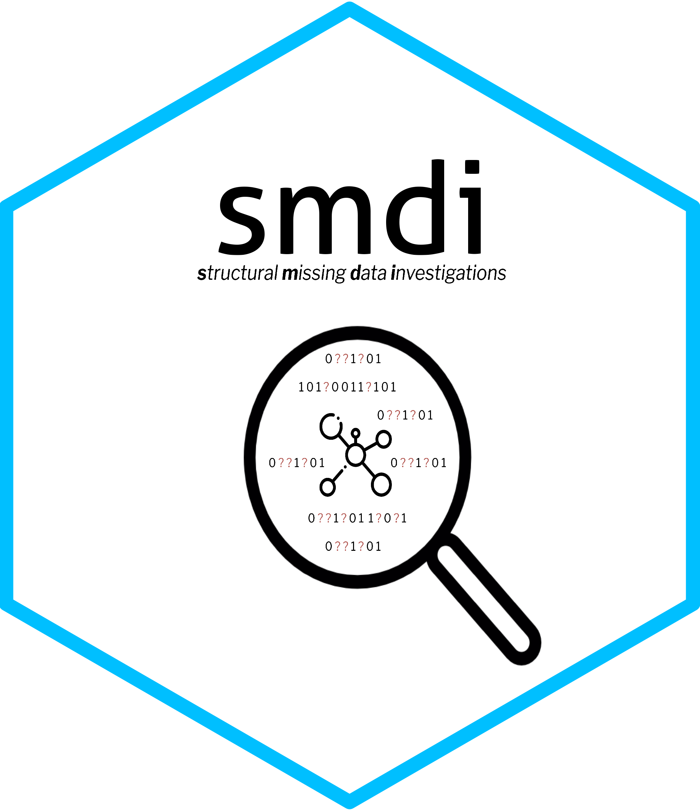

# smdi 

**`S`tructural `M`issing `D`ata `I`nvestigations**

⁠


This package aims to be a helpful addition to routine healthcare
database analytics with a focus on structural missing data
investigations.

The theoretical backbone of this package is based on a large-scale
plasmode simulation performed by the [Sentinel Innovation Center
workgroup](https://www.sentinelinitiative.org/methods-data-tools/methods/approaches-handling-partially-observed-confounder-data-electronic-health):

**Approaches to Handling Partially Observed Confounder Data From
Electronic Health Records (EHR) In Non-randomized Studies of Medication
Outcomes.**

The corresponding manuscripts are published open access:

Weberpals J, Raman SR, Shaw PA, Lee H, Russo M, Hammill BG, Toh S,
Connolly JG, Dandreo KJ, Tian F, Liu W, Li J, Hernández-Muñoz JJ, Glynn
RJ, Desai RJ. *A Principled Approach to Characterize and Analyze
Partially Observed Confounder Data from Electronic Health Records*.
**Clin Epidemiol**. 2024 May 21;16:329-343. [doi:
10.2147/CLEP.S436131.](https://www.dovepress.com/a-principled-approach-to-characterize-and-analyze-partially-observed-c-peer-reviewed-fulltext-article-CLEP)
PMID: 38798915; PMCID: PMC11127690.

Weberpals J, Raman SR, Shaw PA, Lee H, Hammill BG, Toh S, Connolly JG,
Dandreo KJ, Tian F, Liu W, Li J, Hernández-Muñoz JJ, Glynn RJ, Desai RJ.
*smdi: an R package to perform structural missing data investigations on
partially observed confounders in real-world evidence studies*. **JAMIA
Open**. 2024 Jan 31;7(1):ooae008. [doi:
10.1093/jamiaopen/ooae008.](https://www.ncbi.nlm.nih.gov/pmc/articles/PMC10833461/)
PMID: 38304248; PMCID: PMC10833461.

If you encounter any unforeseen errors or have any suggestions, comments
or recommendations, please feel free to reach out to
<janick.developer@gmail.com> or [open an
issue](https://github.com/janickweberpals/smdi/issues).

## Installation

To install the CRAN version of the package, run the following command:

``` r
install.packages("smdi")
```

You can install the latest GitLab release version of `smdi` using the
`devtools` package via:

``` r
devtools::install_git("https://github.com/janickweberpals/smdi.git")
```

To install the development version, please use the `dev` branch:

``` r
devtools::install_git("https://github.com/janickweberpals/smdi.git", ref = "dev")
```

## About

**Objectives:** The objectives of this project were to develop a
framework and tools to assess the structure of missing data processes in
studies utilizing electronic health record (EHR) data.

Missing data in important prognostic factors in EHR are frequent. So
far, the most frequent data taxonomies are:

- **Mechanisms**: Missing completely at random (MCAR), at random (MAR)
  and not at random (MNAR)
- **Patterns**: Monotone, Non-monotone

However, in an empirical study, it is usually unclear which of the
missing data mechanisms and patterns are dominating.

**What did the study find?** In brief, large-scale simulations revealed
that characteristic patterns of diagnostic parameters matched to common
missing data structure based on three group diagnostics:

- **Group diagnostic 1:** Comparison of distributions between patients
  with or without an observed value of the partially observed covariate

- **Group diagnostic 2:** Assessing the ability to predict missingness
  based on observed covariates

- **Group diagnostic 3:** Estimating if the missingness of a covariate
  is associated with the outcome (differential missingness)


**Table 1.** Overview three group diagnostics

**How can this be applied to inform a real-world database study?** The
observed diagnostic pattern of a specific study will give insights into
the likelihood of underlying missingness structures. This is how an
**example** could look like in a real-world database study:


**Table 2.** Example of how `smdi` diagnostics can be applied to give
insights into the likelihood of underlying missingness structures in a
real-world database study.

  

While the manuscript is underway, in the meantime please refer to the
[presentation at the 2023 Innovation
Day](https://www.youtube.com/embed/Dml_AP0ohTY?start=7376) to learn
more.

## Package website

Check out the `smdi` pkgdown website:

[janickweberpals.gitlab-pages.partners.org/smdi](https://janickweberpals.gitlab-pages.partners.org/smdi)

## Further references

*This project builds up on pivotal work done by several groups and
recently published frameworks and guidance papers*

Weberpals J, Raman SR, Shaw PA, Lee H, Russo M, Hammill BG, Toh S,
Connolly JG, Dandreo KJ, Tian F, Liu W, Li J, Hernández-Muñoz JJ, Glynn
RJ, Desai RJ. A Principled Approach to Characterize and Analyze
Partially Observed Confounder Data from Electronic Health Records.
**Clin Epidemiol**. 2024 May 21;16:329-343. [doi:
10.2147/CLEP.S436131.](https://www.dovepress.com/a-principled-approach-to-characterize-and-analyze-partially-observed-c-peer-reviewed-fulltext-article-CLEP)
PMID: 38798915; PMCID: PMC11127690.

Weberpals J, Raman SR, Shaw PA, Lee H, Hammill BG, Toh S, Connolly JG,
Dandreo KJ, Tian F, Liu W, Li J, Hernández-Muñoz JJ, Glynn RJ, Desai RJ.
smdi: an R package to perform structural missing data investigations on
partially observed confounders in real-world evidence studies. **JAMIA
Open**. 2024 Jan 31;7(1):ooae008. [doi:
10.1093/jamiaopen/ooae008.](https://www.ncbi.nlm.nih.gov/pmc/articles/PMC10833461/)
PMID: 38304248; PMCID: PMC10833461.

Sondhi A$`^1`$, Weberpals J$`^1`$, Yerram P, Jiang C, Taylor MD, Samant
M, Cherng S. A Systematic Approach Towards Missing Lab Data in
Electronic Health Records: A Case Study in Non-Small Cell Lung Cancer
and Multiple Myeloma. **CPT Pharmacometrics Syst Pharmacol**. 2023 Jun
15. doi: 10.1002/psp4.12998. Epub ahead of print. PMID: 37322818.

Lee KJ, Tilling KM, Cornish RP, Little RJA, Bell ML, Goetghebeur E,
Hogan JW, Carpenter JR; STRATOS initiative. Framework for the treatment
and reporting of missing data in observational studies: The Treatment
And Reporting of Missing data in Observational Studies framework. **J
Clin Epidemiol**. 2021 Jun;134:79-88. doi:
10.1016/j.jclinepi.2021.01.008. Epub 2021 Feb 2. PMID: 33539930; PMCID:
PMC8168830.

Carpenter JR, Smuk M. Missing data: A statistical framework for
practice. **Biom J**. 2021 Jun;63(5):915-947. doi:
10.1002/bimj.202000196. Epub 2021 Feb 24. PMID: 33624862.
